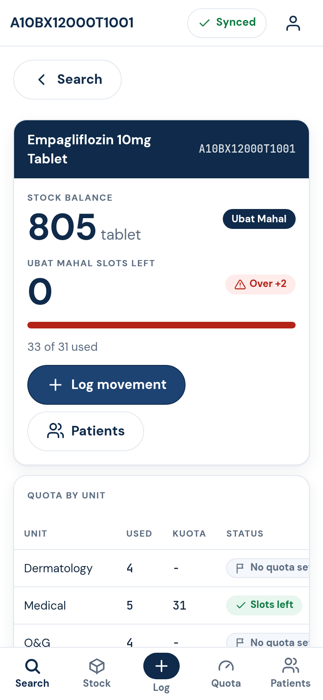

# Hospital Limbang Drug Formulary

This repository is the app, not a hospital's drug database. Hospital Limbang built it for its own pharmacy. Another hospital can copy this structure and run it for its own staff, with its own drugs, stock, and accounts.

The live Limbang site is [https://limbang-formulary.web.app](https://limbang-formulary.web.app). Cloning this repository does not include that site's formulary, stock balances, patients, staff passwords, or drug photographs. Those stay in that hospital's Firebase project.

## For another hospital

1. Copy this repository.
2. Create your own Firebase project on the free Spark plan. Do not point it at `limbang-formulary`.
3. Put your project's web config in `public/js/firebase-config.js`, then `npx firebase use --add`. The steps are in [docs/deploy.md](docs/deploy.md).
4. Load your own formulary, locations, and par levels with the seed scripts. Patients stay as fake DEMO rows until your hospital has approval to host real names and identity-card numbers.

What you get is the staff app: drug search, the drug page, the Kad Stok tally card, Ubat Mahal quotas, and the stock log. You also get the Firestore security rules and the scripts that build and load data. There is no server to run. `firestore.rules` is the permission check.

What you do not get, because it is each hospital's own data:

- the drug catalogue, clinical text, and stock
- drug photographs (`public/drugs/`) and the photo index (`public/shared/drug-photos.local.js`)
- patients, staff accounts, and passwords
- the Firebase service-account key

A fresh copy shows a grey block where a photograph would be, until that hospital hosts its own pictures with `scripts/host-drug-photos.js`.

## What the app does

A staff-only app to look up drugs, watch Ubat Mahal quotas and patients, and log stock movements. It runs in the browser on iPhone, Android and PC, keeps working with no internet, and syncs when the connection returns.

It is hosted on Firebase on the free Spark plan: Hosting for the app, Firestore for data, Firebase Auth for sign-in. There is no server code; `firestore.rules` enforces every permission.



## Quick start (local, emulators only)

Needs Node 20, Java 11+ (for the emulators) and Chrome (for e2e tests).

```
npm install
npm run emulators                                   # terminal 1
npm run seed:emulator -- --data /path/to/data       # terminal 2: formulary, quotas, locations, par, DEMO patients
npm run admin:emulator -- create-admin alvin        # prints a temporary password once
npm run dev                                         # open http://127.0.0.1:5055
```

On localhost the app only talks to the emulators. Deploying and seeding the real project: `docs/deploy.md`.

## Who can do what

| Role | Can do |
| --- | --- |
| admin | Everything. Adds staff, edits locations, imports data, reads the audit log. |
| pharmacist | Edits quotas, logs stock, sees and edits patients. |
| ward | Searches drugs, sees quota counts and stock, logs movements for their own ward. Sees no patients. |

No self sign-up. An admin creates each account in Admin > Users.

## Using the app

- **Search**: find a drug by name, code, brand, class or indication. Results show as a card gallery (packaging photo, brand, class, prescriber category, indication, dosage, code, procurement) or a compact list. Tap a drug for its information (indications, dosage, administration, dilution, renal, hepatic, pregnancy, breastfeeding, supply and price), where that drug is kept, then stock, par, quota and recent movements.
- **Kad Stok**: each drug at each location has a stock card laid out like the pink paper card (Tarikh, No. PK/BTB/BPSS/BPSI/BPIN, Terima Daripada / Keluar Kepada, Terimaan, Keluaran, Baki, Nama Pegawai). Open it from a drug's stock rows. On a phone the table scrolls sideways with Tarikh pinned. See [docs/domain.md](docs/domain.md#kad-stok-stock-card-view).
- **Log** (Isi Kad Stok): fill one card row in card order: Tarikh, document, Terimaan / Keluaran / Kiraan stok, from or to (a location, a typed name, or Pelarasan stok), Kuantiti, optional Seunit (RM). Works offline. The badge shows Synced, Pending, Offline or Needs attention.
- **Quota**: slots left for each Ubat Mahal drug. Green is fine, amber from 80 percent, full and over are red.
- **Patients** (admin and pharmacist): choose a drug to list its patients. The IC is hidden until you tap it, and every tap is audited. Trial project: DEMO patients only.
- **Admin**: Users, Locations, Import and Audit.

## Tests

```
npm test            # unit tests
npm run test:rules  # security rules for admin, pharmacist, ward, disabled and signed-out users
npm run test:e2e    # headless Chrome against the emulators
npm run screens     # Kad Stok screenshots (docs/screens/12-14) on the emulators, synthetic data
```

## More

- `docs/deploy.md`: deploy, seed, credentials, read budget, moving to the MOH account.
- `docs/domain.md`: data shapes.
- `docs/security.md`: what is stored where, and the risks.
